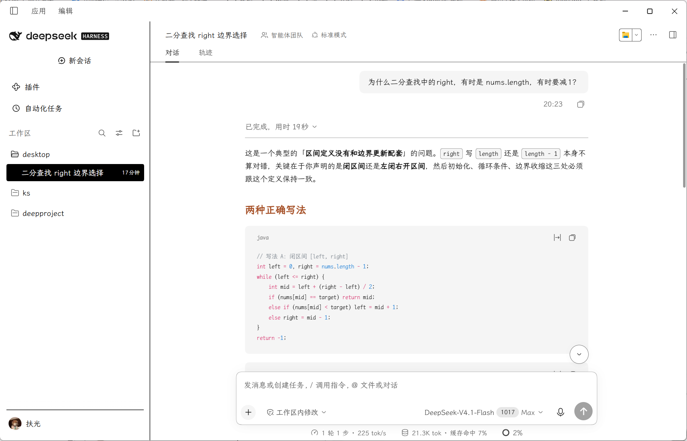
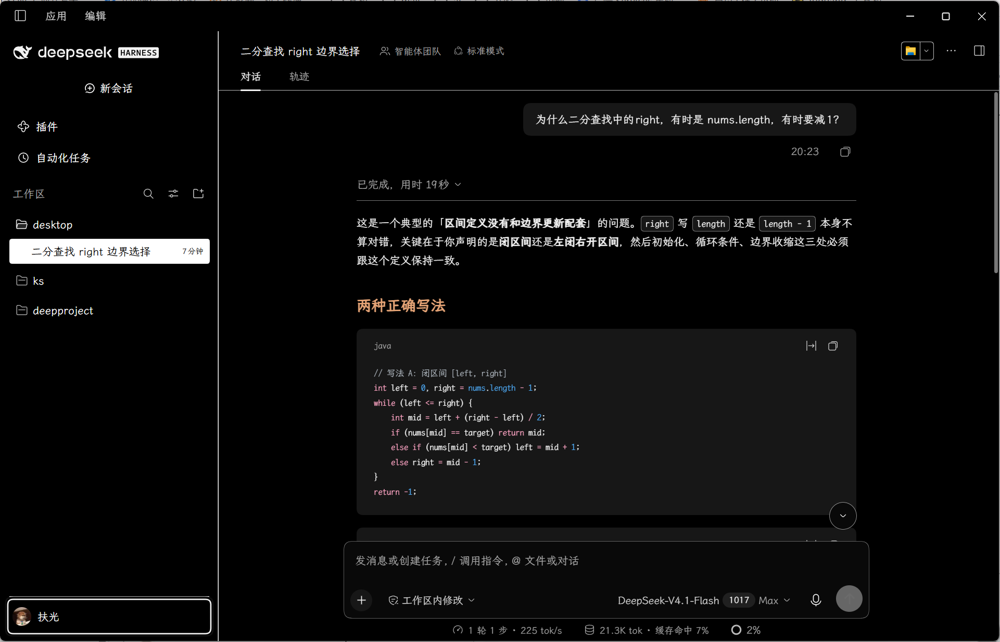

# 墨白 · Inkstone

平时用 Obsidian 记笔记，觉得它的阅读和写作体验很舒服，就想把自己喜欢的这份体验也带到 DeepSeek Harness 里，于是写了「墨白」。

适用于 [DeepSeek Harness](https://github.com/deepseek-ai/deepseek-harness) 的独立社区主题，以黑白配色、霞鹜文楷和安静的阅读排版为主。参考 [Obsidian Minimal](https://github.com/kepano/obsidian-minimal) 的 E-ink 风格，针对 DSH 的布局和主题接口重新实现。

本项目与 DeepSeek、Obsidian、Minimal 及其作者没有官方合作或背书关系。项目名称为「墨白 / Inkstone」，包名为 `dsh-theme-inkstone`。

## 预览

下图为 **DSH 0.2.1-rc.2 Windows 桌面端实机截图**，展示二分查找演示会话。取图时停用了其他社区插件；实际布局由 DSH 版本与已启用插件决定。

图片使用原始 PNG 文件，保留原始分辨率，未缩放或重新压缩。




## 特性

- 浅色白底墨字、深色黑底浅字，跟随 DSH 原生外观模式。
- 侧栏条目默认无框，悬浮与选中时黑白反色，图标和时间一起反转；细线用于面板分隔。
- 使用本机已安装的「霞鹜文楷」「霞鹜文楷等宽」，未安装时回退到系统字体；原生自定义字体优先。
- Markdown 标题使用红、橙、黄、绿、蓝、紫六级颜色，并保留状态提示及代码差异颜色。
- 保留原生字号、操作方式和键盘焦点；禁用插件时释放样式与 token 覆盖。
- 无第三方运行时依赖，不读取会话，不调用模型，不打包或下载字体。

## 兼容性

当前仅声明支持已验证的 **DSH 0.2.1-rc.2**，开发和本地预览需要 **Node.js 24+**。详见 [验证范围](docs/VALIDATION.md)。

主题通过 `ctx.theme.overrideTokens` 注册；侧栏和 Markdown 的少量样式依赖 DSH 的 CSS Modules 局部名称。未来宿主更新可能需要适配。请避免同时启用覆盖相同颜色的其他主题。

## 安装

### 插件市场（申请收录中）

已向 [awesome-dsh-plugin 目录提交收录申请 #8107](https://github.com/awesome-dsh-plugin/awesome-dsh-plugin/pull/8107)，归类为主题，并指定预构建安装包。该目录是社区市场 [dshmarket](https://github.com/dsh-market/dsh-market) 的数据来源。

**目前尚未完成收录。** 等待目录审核合并并刷新后，使用该市场的用户可在「主题」中搜索 `Inkstone`、`墨白` 或 `dsh-theme-inkstone`，核对兼容的宿主版本后安装。申请期间请使用下面的 Release 安装方式。

### 推荐：预构建安装包

从 [Releases](https://github.com/fuguang12123/dsh-theme-inkstone/releases) 下载 `dsh-theme-inkstone-0.1.4.tgz`。桌面版先完全退出 DSH，再运行：

```sh
dsh plugin --profile desktop add ./dsh-theme-inkstone-0.1.4.tgz
```

重新打开 DSH，在插件列表确认「墨白 / Inkstone」。Web 用户请把 `desktop` 替换为自己实际使用的 profile。若未配置 `dsh` 命令，请先按 DSH 官方说明完成 CLI 配置。

预构建包不需要运行安装时构建脚本。校验值随 Release 提供：

```powershell
Get-FileHash ./dsh-theme-inkstone-0.1.4.tgz -Algorithm SHA256
```

### 从 GitHub 源码安装

```sh
dsh plugin --profile desktop add github:fuguang12123/dsh-theme-inkstone#v0.1.4
```

包提供自包含的 `prepare` 脚本。pnpm 如果阻止 Git 依赖的构建，请先检查源码，再根据安装输出把确切包键加入该 profile 的 `pnpm-workspace.yaml` 中的 `allowBuilds`，随后重试；也可以使用上面的预构建包。需要固定来源时，把 tag 替换成 Release 对应的完整 commit SHA。参考 [DSH 打包与安装指南](https://github.com/deepseek-ai/deepseek-harness/blob/master/docs/user/develop/basic/publish.zh.md)。

### 停用与卸载

在插件页停用墨白即可撤销主题。卸载前先退出桌面端：

```sh
dsh plugin --profile desktop remove dsh-theme-inkstone
```

## 本地开发与预览

无第三方构建依赖，克隆后即可运行：

```sh
node scripts/build.mjs
node --test tests/theme.test.mjs
node scripts/preview.mjs
```

浏览器打开 `http://127.0.0.1:4318`，支持浅色、深色、字体与字号调整、会话搜索及示例消息输入。预览不连接模型。可以通过 `PORT` 环境变量更换端口。

修改 `src/tokens.mjs` 与 `src/theme.css` 后重新构建；生成的 `dist/` 一并提交，保持源码与发布入口一致。生成安装包：

```sh
mkdir release
npm pack --pack-destination release
```

`cordis.patch.yml` 以包名插入主题行，`./client` 导出浏览器 lazy-CJS 模块；Host 入口不执行额外业务操作。

## 来源与许可

本项目代码采用 [MIT](LICENSE) 许可。设计参考、第三方版权声明与许可证见 [THIRD_PARTY_NOTICES.md](THIRD_PARTY_NOTICES.md)。本项目不分发 Minimal 整套主题、Obsidian 应用、DSH 应用或字体文件；不能把第三方内容视为本项目原创。

- [Minimal](https://github.com/kepano/obsidian-minimal)：E-ink 黑白配色与导航反色的设计参考，MIT 许可。
- [DeepSeek Harness](https://github.com/deepseek-ai/deepseek-harness)：插件接口与宿主，MIT 许可；名称用于准确描述兼容关系。
- [霞鹜文楷](https://github.com/lxgw/LxgwWenKai)：本地字体名称引用，字体自身遵循 SIL OFL 1.1。

## English

Inkstone is an independent community theme for DeepSeek Harness, inspired by the monochrome reading style of Obsidian Minimal E-ink. It supports native appearance preferences, inverted sidebar interactions and locally installed LXGW WenKai fonts. It bundles no fonts or upstream applications and makes no model requests. Tested host: **0.2.1-rc.2**. Download a prebuilt tarball from Releases and install it with `dsh plugin --profile desktop add ./dsh-theme-inkstone-0.1.4.tgz` after exiting the desktop app. This project is not affiliated with or endorsed by DeepSeek, Obsidian or the Minimal authors.
